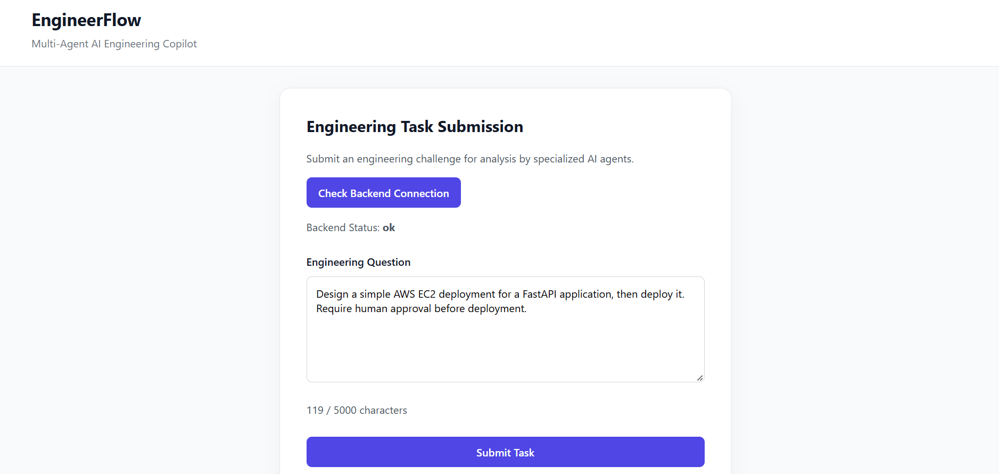
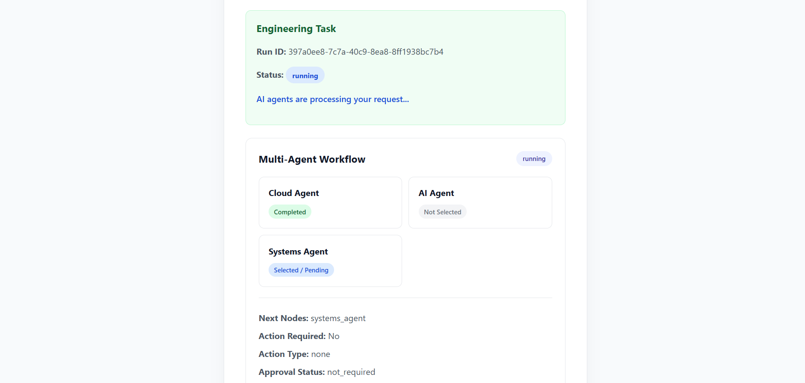
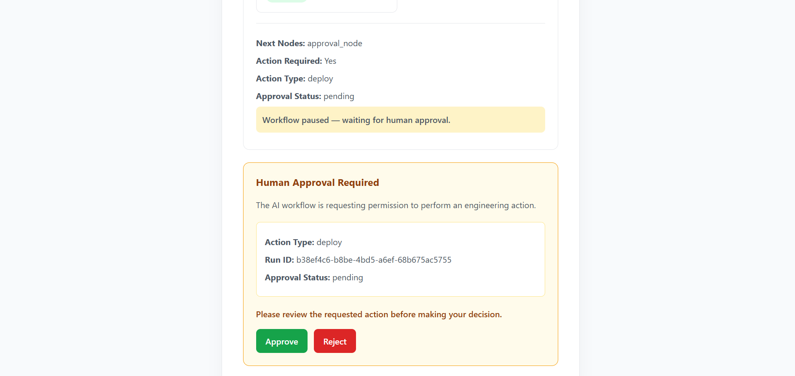
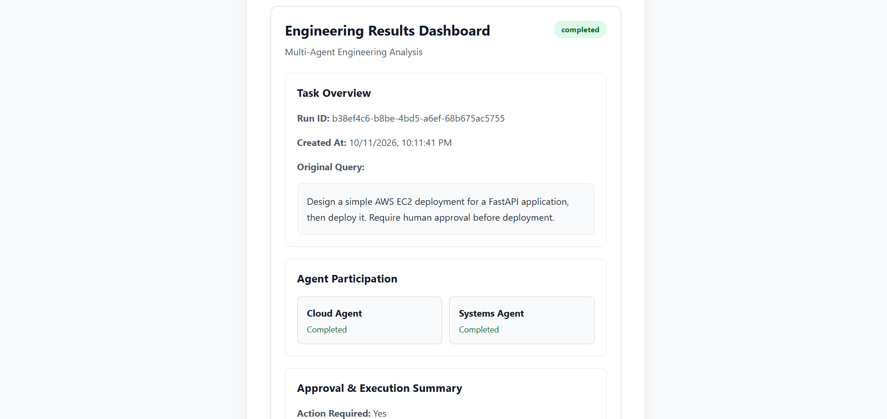
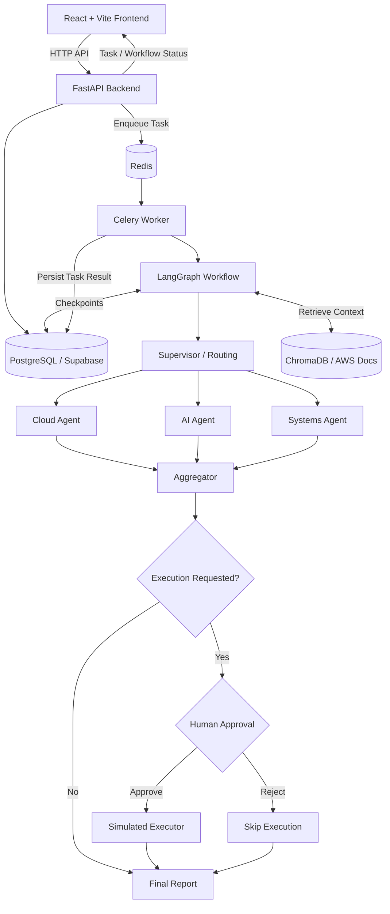

# EngineerFlow — Multi-Agent AI Engineering Copilot

EngineerFlow is a full-stack, multi-agent AI engineering assistant that analyzes technical requests, coordinates specialized agents, and produces consolidated engineering recommendations. For requests involving an engineering action, the workflow can pause for **human approval** before continuing.

> **Project status:** Local development prototype. Action execution is **simulated**; EngineerFlow does not deploy resources to AWS.

## Features

- **Multi-agent orchestration:** LangGraph coordinates Cloud, AI, and Systems agents.
- **Engineering analysis:** Generates a consolidated report from agent contributions.
- **Retrieval-augmented generation (RAG):** Uses ChromaDB to retrieve relevant AWS documentation context.
- **Asynchronous processing:** FastAPI submits tasks to Celery workers backed by Redis.
- **Durable workflows:** PostgreSQL stores task records and LangGraph checkpoints.
- **Human-in-the-loop (HITL):** Execution requests pause for approval or rejection before the workflow resumes.
- **React dashboard:** Submit tasks, track workflow progress, approve/reject actions, and read final reports.

## Demo: End-to-End Workflow

The screenshots below illustrate a typical task, from submission to final results. Replace each placeholder image with a screenshot from your running application.

### 1. Submit a User Query

Enter an engineering request in the React interface. For example:

> Design a simple AWS EC2 deployment for a FastAPI application, then deploy it. Require human approval before deployment.



### 2. Monitor the Multi-Agent Workflow

Follow task status and see which agents have completed their analysis.



### 3. Human Approval Required

For a detected execution request, the workflow pauses at the approval step. The user can **Approve** or **Reject** the requested action.



### 4. View the Results Dashboard

After the workflow finishes, inspect the final engineering report, participating agents, approval status, and action result.




## Architecture



### How it works

1. The user submits a technical question through the React frontend.
2. FastAPI creates a task and queues background processing through Celery and Redis.
3. LangGraph coordinates the appropriate engineering agents and aggregates their analysis.
4. If an execution action is requested, LangGraph pauses for human approval.
5. After approval or rejection, the workflow resumes, records the outcome, and completes.
6. The frontend polls task and workflow endpoints and displays the final report.

## Tech Stack

| Layer | Technologies |
|---|---|
| Frontend | React, Vite, JavaScript, CSS |
| Backend API | Python, FastAPI |
| Agent Orchestration | LangGraph, OpenAI API |
| RAG | ChromaDB, AWS documentation |
| Background Jobs | Celery, Redis |
| Persistence / Checkpoints | PostgreSQL, Supabase, LangGraph PostgresSaver |
| Local Infrastructure | Docker (Redis) |
| Testing | Pytest, Vitest, React Testing Library, ESLint |

## API Endpoints

| Method | Endpoint | Purpose |
|---|---|---|
| `GET` | `/health` | Check backend health |
| `POST` | `/api/tasks` | Submit an engineering task |
| `GET` | `/api/tasks/{run_id}` | Retrieve task status and results |
| `GET` | `/api/tasks/{run_id}/state` | Retrieve workflow progress |
| `POST` | `/api/tasks/{run_id}/approval` | Approve or reject a pending action |

## Run Locally

### Prerequisites

- Python 3.10+ and Node.js
- Docker Desktop (for Redis)
- A PostgreSQL database / Supabase project
- An OpenAI API key
- Backend dependencies installed in a Python virtual environment

### 1. Configure environment variables

Configure the backend environment file at the repository root (`.env`) with the values required by your backend, including:

```dotenv
OPENAI_API_KEY=your_openai_api_key
DATABASE_URL=your_postgresql_connection_string
CORS_ALLOWED_ORIGINS=http://localhost:5173,http://127.0.0.1:5173
```

Create `frontend/.env`:

```dotenv
VITE_API_BASE_URL=http://127.0.0.1:8000
```

**Never commit `.env` files or credentials.** The backend also requires its Python packages and local RAG data to be set up; check the repository's backend configuration before running.

### 2. Start Redis

If the `engineerflow-redis` Docker container has already been created:

```powershell
docker start engineerflow-redis
docker exec engineerflow-redis redis-cli ping
```

The ping command should return `PONG`.

### 3. Start Celery Worker

Open a terminal at the repository root:

```powershell
.\.venv\Scripts\Activate.ps1
celery -A backend.worker.celery_app:celery_app worker --loglevel=info --pool=solo
```

The `--pool=solo` option is used for this Windows development setup.

### 4. Start FastAPI

In a separate terminal at the repository root:

```powershell
.\.venv\Scripts\Activate.ps1
python -m uvicorn backend.api.main:app --reload
```

- Health check: http://127.0.0.1:8000/health
- API docs: http://127.0.0.1:8000/docs

### 5. Start React

In another terminal:

```powershell
cd frontend
npm install
npm run dev
```

Open http://localhost:5173/.

## Testing

Frontend:

```powershell
cd frontend
npm run test
npm run build
npm run lint
```

The Results Dashboard currently has five automated component tests covering report display, agent participation, approval status, hidden state during processing, and rejection information.

Backend (from repository root, if the tests are located in `backend/tests`):

```powershell
python -m pytest backend/tests -v
```

Manual end-to-end flows verified during development include analysis-only completion, approval, and rejection. Automated component tests are **not** a substitute for full browser E2E tests.

## Safety and Current Limitations

- Engineering actions are **simulated**, not executed against live AWS infrastructure.
- The current task API exposes a consolidated `final_response`; it does not expose complete individual agent reports.
- The Results Dashboard displays the consolidated report as plain text rather than rendering Markdown.
- This is a development prototype, not a production-hardened deployment platform.

## Future Improvements

- Rich Markdown rendering for engineering reports
- Individual agent output views and citations
- Browser end-to-end tests and GitHub Actions CI
- Authentication, authorization, and audit logging
- Deployment packaging, observability, and production hardening

## License

Add a `LICENSE` file if you decide to release this project under an open-source license.
